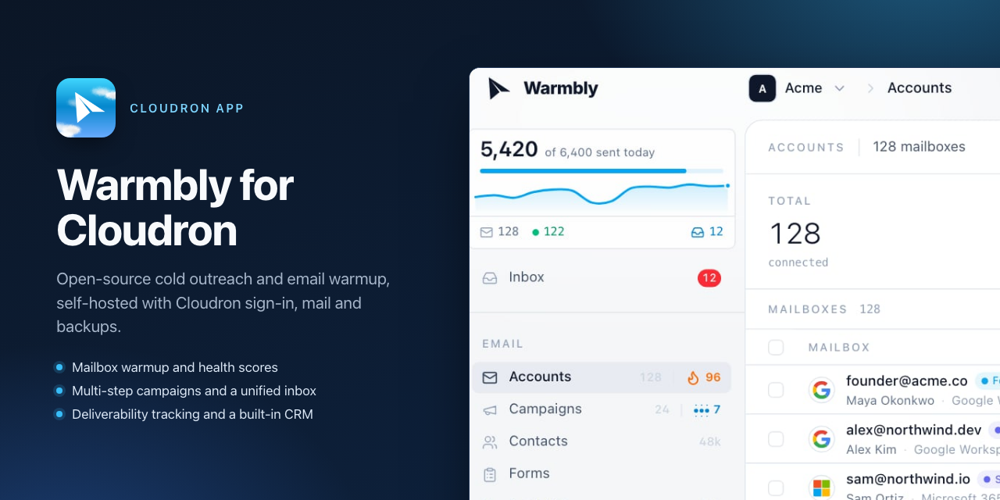
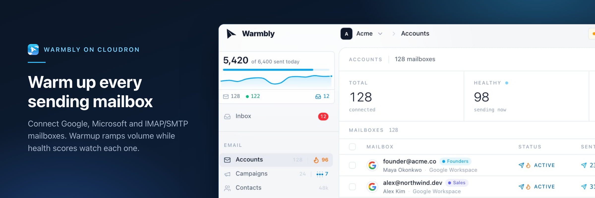
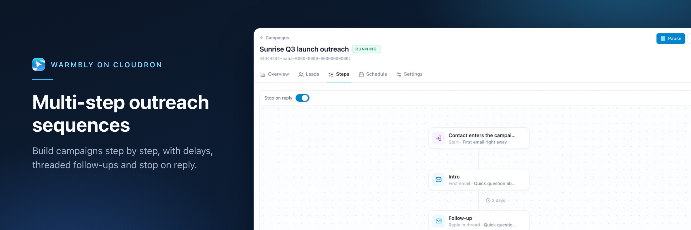
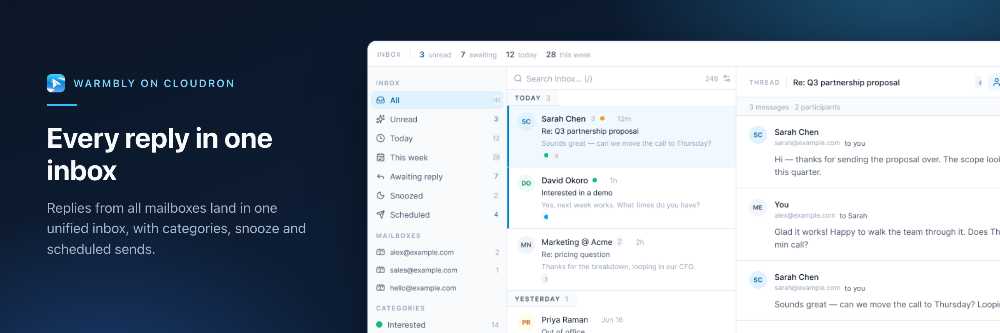
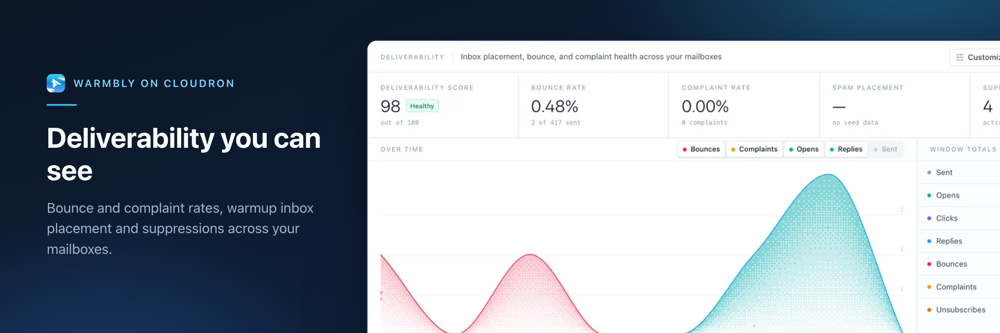
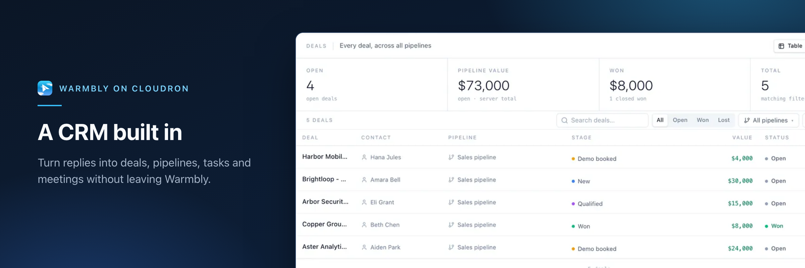

# Warmbly for Cloudron



Cloudron package for [Warmbly](https://github.com/warmbly/warmbly), the
open-source B2B cold outreach platform: connected mailboxes, email warmup,
multi-step campaigns, a unified inbox, contacts and lead-capture forms, with
open and click tracking.



| | |
|---|---|
|  |  |
|  |  |

Screenshots: Warmbly's own product images (Apache-2.0), framed for the
Cloudron store. See [DESIGN.md](DESIGN.md).

## What the package adds

- **One app, five addresses.** The dashboard on the app's location, plus
  secondary domains for the API, the admin panel, open/click tracking and
  hosted forms. Cloudron issues every certificate.
- **Cloudron single sign-on.** Users with access to the app sign in with their
  Cloudron account (`oidc` addon); the first sign-in creates their Warmbly
  account. Password sign-up stays invitation-only, and is closed until the
  owner has claimed the instance.
- **Platform email through Cloudron.** Sign-in codes, password resets,
  invitations and digests go through the Cloudron mail relay (`sendmail`
  addon, STARTTLS with certificate verification).
- **Everything on Cloudron's services.** PostgreSQL and Redis addons; the
  event bus (NATS JetStream), attachments, worker state and secrets under
  `/app/data`, all included in Cloudron backups.
- **Pinned upstream.** Upstream's release images, pinned by digest, for the
  API, consumer, worker, tracking, forms, dashboard and admin panel. The
  realtime gateway is rebuilt from the same upstream commit on glibc.

## Install

**From the catalog** (once a version is published). In the Cloudron dashboard,
open *Settings → Community apps*, add the catalog URL below and install Warmbly
from the App Store, or use the CLI:

```sh
cloudron install --versions-url https://raw.githubusercontent.com/marcusquinn/cloudron-warmbly-app/main/CloudronVersions.json --location warmbly.example.com
```

**From source.** Cloudron builds the image on your server (allow about 5
minutes):

```sh
git clone https://github.com/marcusquinn/cloudron-warmbly-app.git
cd cloudron-warmbly-app
cloudron install --location warmbly.example.com
```

Either way, the CLI asks for the four secondary domains, or pass them:

```sh
cloudron install --location warmbly.example.com \
  --secondary-domains API_DOMAIN=warmbly-api.example.com,ADMIN_DOMAIN=warmbly-admin.example.com,TRACK_DOMAIN=t.example-links.com,FORM_DOMAIN=forms.example.com
```

`cloudron update --app warmbly.example.com` rebuilds from a newer checkout. To
move a source-built install onto the catalog, keeping its data and domains
(Cloudron CLI 9.0 or later; the update takes a backup first):

```sh
cloudron update --app warmbly.example.com --force \
  --versions-url https://raw.githubusercontent.com/marcusquinn/cloudron-warmbly-app/main/CloudronVersions.json
```

Requirements: Cloudron 9.1 or later, 2 GiB of memory for the app (raise it in
the app's *Resources* for many mailboxes).

### Choosing the tracking domain

Every campaign's open pixel, click links and unsubscribe page carry the
tracking domain. If recipients complain about one workspace, URL blocklists
list that host, and the listing reaches its registered domain. Use a
**separate registered domain** for tracking (for example `t.example-links.com`),
not a subdomain of your main site or mail domain. `warmblyctl status` warns
when they share a domain.

## Set up

1. **Claim the instance.** With Cloudron single sign-on (the default), open
   the app and choose *Continue with* your Cloudron (the button carries your
   Cloudron's name). The first person to sign in becomes the owner and
   platform admin; on an unclaimed instance the sign-in screen says so. No
   email or password is needed: your Cloudron account decides who signs in.
   Upstream only shows its single sign-on button after an email has been
   typed, and ignores that email; the package adds the button to the first
   screen ([`web-extra/cloudron-sso.js`](web-extra/cloudron-sso.js)). The
   owner grant is a package patch
   ([`patches/0001-cloudron-oidc-first-user-owner.patch`](patches/0001-cloudron-oidc-first-user-owner.patch));
   it grants admin only while no account holds admin, so nobody after the
   first can claim it. Until then, password, Apple and Google sign-ups are
   refused, so nobody can create the first account ahead of the owner. To
   use the upstream claim link instead, set
   `WARMBLY_OIDC_FIRST_USER_OWNER=false` in `/app/data/env` and **restart the
   app** (the setting is read at start). Without SSO, or with that set, run
   in the app's *Terminal*:

   ```sh
   warmblyctl setup-link
   ```

   Open the link and create the owner account and first organization. The link
   is single-use; run the command again for a new one.
2. **Invite the team,** or let them sign in with Cloudron. Each new SSO user
   gets their own organization unless `OIDC_DEFAULT_ORG` in `/app/data/env`
   names the organization id they should join. Who can sign in with Cloudron
   is set by the app's *Access control*.
3. **Connect sending mailboxes** in the dashboard. IMAP/SMTP mailboxes work
   out of the box, including mailboxes on Cloudron Mail. For Gmail and
   Microsoft 365 OAuth, see [Mailbox OAuth](#mailbox-oauth).
4. **Check the instance:**

   ```sh
   warmblyctl status
   ```

## Customer tracking domains

Workspaces can put campaign links on their own domain, for example
`links.customer.com`, a CNAME to your tracking domain. Cloudron only serves
domains in the app's *Location*, so add each one there as an **alias**.
Cloudron then issues its certificate, and the package routes any host it does
not otherwise recognise to the tracking service. Then verify the domain in
Warmbly.

## Mailbox OAuth

Gmail and Microsoft 365 mailboxes connect with OAuth clients you register:

| Provider | Redirect URI | Keys in `/app/data/env` |
|---|---|---|
| Google (Web application client) | `https://<API domain>/addresses/google/callback` | `BOX_GOOGLE_CLIENT_ID`, `BOX_GOOGLE_CLIENT_SECRET` |
| Microsoft (Entra app registration) | `https://<API domain>/addresses/outlook/callback` | `BOX_OUTLOOK_CLIENT_ID`, `BOX_OUTLOOK_CLIENT_SECRET` |

Restart the app after setting them. Without them, connected OAuth mailboxes
stop syncing when their tokens expire, and the start log says so.

## Configuration

Settings live in `/app/data/env` (`KEY=value`, one per line; edit with the
*File manager* or *Terminal*, then restart the app). The file starts with
commented examples for registration and sign-in, another SMTP relay, mailbox
OAuth, your brand in transactional email, an AI provider, data retention, and
a GeoLite2 database for location labels.

The package owns the database, Redis, URLs, listeners, the event bus, storage
and secrets. Those keys are ignored in `/app/data/env`, and the log names each
one. Upstream reference:
<https://docs.warmbly.com/development/configuration/>.

## Operator CLI

`warmblyctl` in the app's *Terminal* runs upstream's operator CLI with the
app's environment:

| Command | Does |
|---|---|
| `warmblyctl status` | Version, accounts, mail transport, and instance checks (URLs, tracking domain, realtime socket, mail) |
| `warmblyctl setup-link` | Single-use link that claims an unclaimed instance |
| `warmblyctl user create --email you@example.com --admin` | Create an account directly |

## Backups

Cloudron backs up PostgreSQL, Redis and `/app/data`. Keep backups:
`/app/data/.secrets.env` holds the keys that decrypt connected mailbox
credentials. Without it, every mailbox must be reconnected.

## Limits

- **Single node.** API, consumer, worker, tracking, forms, realtime and NATS
  run in one container. Upstream's multi-node worker fleet is not used.
- **Billing** is disabled. CAPTCHA, product analytics and error reporting
  stay off unless you set the upstream keys.
- **Update checks** are off; updates come from this package.
- **Realtime for developer clients.** The dashboard's live updates run
  through the API domain. `GET /v1/auth/config` still reports the gateway's
  internal address as `websocket_url`, so upstream's CLI event stream and SDKs
  cannot discover the socket on this package. The API uses that same setting
  to reach the gateway, so it cannot be made public without an upstream
  change.

## Troubleshooting

| Symptom | Check |
|---|---|
| App will not start | *Logs* in the dashboard, or `cloudron logs --app <app>`. A malformed `/app/data/env` line is reported and skipped. |
| Sign-in emails do not arrive | *Email → Outbound* status in Cloudron; the start log shows `platform mail: smtp`. |
| No Cloudron sign-in button | The app was installed without Cloudron user management; use the setup link and password sign-in. |
| Opens and clicks do not record | `https://<tracking domain>/health` must answer `OK`; for a customer domain, it must be an alias of the app. |
| Dashboard does not update live | `warmblyctl status`; the realtime socket runs through the API domain at `/v1/realtime/socket/websocket`. |

Packaging bugs: [GitHub issues](https://github.com/marcusquinn/cloudron-warmbly-app/issues).

## Documentation

- [docs/PUBLISHING.md](docs/PUBLISHING.md): release pipeline, catalog and
  Cloudron Community Apps listing.
- [DESIGN.md](DESIGN.md): store artwork, banner and screenshot provenance.

## License

Packaging: MIT ([LICENSE](LICENSE)). Warmbly: Apache-2.0, © its authors. This
package is maintained independently of the Warmbly project.
